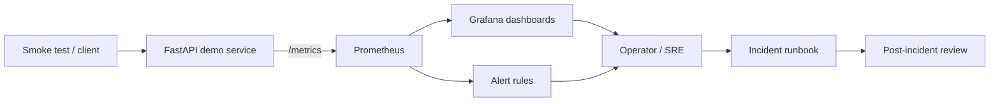

<div align="center">


### Measure the service · Detect the signal · Respond with evidence

[](https://prometheus.io/)
[](https://grafana.com/)
[](https://fastapi.tiangolo.com/)
[](https://docs.docker.com/compose/)

**A local SRE lab for instrumenting a service, collecting RED metrics, visualizing latency and error behavior, and connecting alerts to incident response.**

[Architecture](#-observability-architecture) · [Run the lab](#-run-the-lab) · [PromQL](#-promql-recipes) · [SRE runbooks](#-operational-playbooks)

</div>

> [!WARNING]
> This is a local learning environment. Default Grafana credentials are for local-only use; change them before sharing the environment and never expose the services publicly as configured. The sample SLOs are learning targets, not measured availability or an SLA.

## What problem does it solve?

A service can be running while users experience slow requests or elevated failures. This project demonstrates a basic observability loop: instrument the application, scrape metrics, visualize service behavior, evaluate alert conditions and guide the operator through a runbook.

## Observability architecture



## What is included

| Capability | Implementation | Why it matters |
|---|---|---|
| Application telemetry | FastAPI health and metrics endpoints | Exposes service state and measurements |
| Metrics collection | Prometheus scrape configuration | Time-series data for analysis |
| Dashboards | Provisioned Grafana JSON | Shared, version-controlled views |
| Alerting | Prometheus rule examples | Detects selected failure conditions |
| SLI signals | Request rate, latency, errors, scrape health | Measures user-facing behavior |
| Operations | Smoke tests, incident runbook, postmortem template | Turns telemetry into action |

The repository also contains related learning projects for Secure GitOps, Azure cost guardrails and Terraform policy enforcement under `projects/`. They are separate examples, not components required by the core observability stack.

## Run the lab

### Prerequisites

- Docker Desktop or Docker Engine.
- Docker Compose plugin.
- Ports 8000, 9090 and 3000 available locally.

### Start

```powershell
docker --version
docker compose version
docker compose up --build -d
docker compose ps
```

### Open the local services

| Service | URL | Purpose |
|---|---|---|
| API health | http://localhost:8000/health | Service health |
| API docs | http://localhost:8000/docs | Interactive API documentation |
| Metrics | http://localhost:8000/metrics | Prometheus exposition endpoint |
| Prometheus | http://localhost:9090 | Queries and target health |
| Grafana | http://localhost:3000 | Dashboards |

The local Grafana lab credentials currently default to `admin` / `ChangeMeNow!`. Change them before any shared use. Do not reuse these credentials elsewhere.

### Stop

```powershell
docker compose down
```

Use `docker compose down -v` only if you intentionally want to remove named volumes and their stored data.

## PromQL recipes

### Request rate by status

```promql
sum by (status) (rate(http_requests_total{job="demo-api"}[5m]))
```

### p95 request latency

```promql
histogram_quantile(
  0.95,
  sum by (le) (
    rate(http_request_duration_seconds_bucket{job="demo-api"}[5m])
  )
)
```

### 5xx error ratio

```promql
(
  sum(rate(http_requests_total{job="demo-api",status=~"5.."}[5m])) or vector(0)
)
/
clamp_min(sum(rate(http_requests_total{job="demo-api"}[5m])), 1e-9)
```

### API scrape health

```promql
up{job="demo-api"}
```

Confirm metric names and labels from the running `/metrics` endpoint before using these queries. The PromQL examples depend on the application instrumentation and scrape labels in this repository.

## SLI / SLO thinking

Use the lab to explore four questions:

1. **Availability:** what proportion of eligible requests succeeded?
2. **Latency:** what proportion completed within the chosen threshold?
3. **Errors:** is the failure ratio increasing?
4. **Detection:** how quickly does the monitoring stack surface the issue?

An SLO needs a defined service, measurement window, eligible-event definition and target. An error budget is the tolerated unreliability implied by that target. The included SLO notes are illustrative and must not be reported as measured production performance.

## Operational playbooks

- Confirm Prometheus target health before debugging missing metrics.
- Check application logs and health endpoints before restarting containers.
- Separate client-side 4xx responses from server-side 5xx failures.
- Validate alert expressions with a controlled local test before claiming an alert is verified.
- Record the symptom, impact, timeline, root cause and follow-up actions in the postmortem template.

See the runbooks and SLO notes under `docs/`.

## Repository map

```text
app/                       FastAPI application and metrics
prometheus/                Scrape config and alert rules
grafana/                   Dashboard JSON and provisioning
tests/                     Smoke/validation checks
docs/                      SLO notes, runbooks, postmortem template
projects/                  Related DevSecOps learning projects
.github/workflows/         CI validation
Dockerfile
docker-compose.yml
```

## Validation checklist

- [ ] All Compose services start and remain healthy.
- [ ] Prometheus target for the API is UP.
- [ ] Request metrics increase when traffic is generated.
- [ ] p95 query returns a meaningful time series.
- [ ] A controlled 5xx test is visible in the error-ratio query.
- [ ] Alert behavior is verified rather than inferred from configuration.
- [ ] Genuine Grafana screenshots are captured from the running stack.

## Maintainer

**MD Amirul Haque** · DevOps / DevSecOps / SRE

[GitHub](https://github.com/haqueamir70-coder) · [LinkedIn](https://www.linkedin.com/in/md-amirul-haque/)

<sub>Observability is useful when it changes an operator's next decision.</sub>
