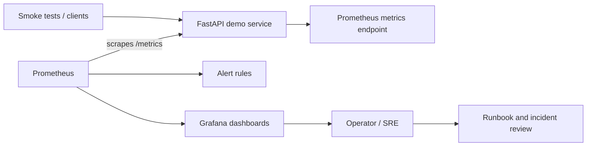

# SRE Observability Platform

<div align="center">


**A hands-on SRE lab for metrics, service health, latency, error ratios, alert rules, and incident response.**

</div>

## Portfolio projects

### 1. SRE Observability Platform
Prometheus, Grafana, FastAPI, Docker Compose, service-level indicators, alert rules, and incident runbooks. Follow the setup and validate locally before claiming runtime verification.

### 2. Secure GitOps Platform
[Kubernetes security and delivery blueprint](projects/secure-gitops-platform/README.md) with a non-root container, hardened Kubernetes manifests, HPA/PDB, NetworkPolicy, Trivy vulnerability scanning, and SBOM generation in GitHub Actions. The CI workflow is committed; inspect the Actions run and validate against a real cluster before describing it as production-ready.

### 3. Azure Cost Guardrails
[Terraform cost governance lab](projects/azure-cost-guardrails/README.md) with a resource-group-scoped monthly budget and forecast/actual threshold notifications. Budget alerts are not hard spending caps; validate in a test subscription.

### 4. Terraform Security Policy Gate
[Terraform security gate](projects/terraform-policy-gate/README.md) with Terraform fmt/validate, Checkov IaC scanning, and OPA/Conftest policy tests that reject insecure Azure Storage settings. CI is designed to run without Azure credentials or deploying resources.

## Architecture



## What this project demonstrates

- Containerized FastAPI service with health and metrics endpoints.
- Prometheus scraping and PromQL queries for request rate, p95 latency, scrape health, and 5xx error ratio.
- Grafana dashboard provisioned from version-controlled JSON.
- Prometheus alert-rule examples for availability and elevated server errors.
- Smoke-test script and incident runbook / postmortem template.
- GitHub Actions CI for basic validation.

## Start locally

Requirements: Docker Desktop with the Docker Compose plugin.

```powershell
docker --version
docker compose version
docker compose up --build -d
docker compose ps
```

Open:
- API health: http://localhost:8000/health
- API docs: http://localhost:8000/docs
- Metrics: http://localhost:8000/metrics
- Prometheus: http://localhost:9090
- Grafana: http://localhost:3000

Grafana local lab credentials default to `admin` / `ChangeMeNow!`. Change them before any shared or exposed deployment. Do not expose these services publicly as configured.

Stop the lab:

```powershell
docker compose down
```

## Useful PromQL

Request rate by status:

```promql
sum by (status) (rate(http_requests_total{job="demo-api"}[5m]))
```

p95 latency:

```promql
histogram_quantile(0.95, sum by (le) (rate(http_request_duration_seconds_bucket{job="demo-api"}[5m])))
```

5xx error ratio:

```promql
(sum(rate(http_requests_total{job="demo-api",status=~"5.."}[5m])) or vector(0))
/
clamp_min(sum(rate(http_requests_total{job="demo-api"}[5m])), 1e-9)
```

API scrape health:

```promql
up{job="demo-api"}
```

## Repository layout

```text
.
├── app/                    # FastAPI app and Prometheus instrumentation
├── grafana/                # Dashboards and provisioning
├── prometheus/             # Scrape configuration and alert rules
├── docs/                   # Runbook, SLO notes, postmortem template
├── tests/                  # Smoke checks
├── projects/
│   ├── secure-gitops-platform/
│   └── azure-cost-guardrails/
├── .github/workflows/      # CI validation
├── Dockerfile
└── docker-compose.yml
```

## SRE practice checklist

- [ ] Start the stack and confirm all containers are healthy.
- [ ] Verify the API target is `UP` in Prometheus.
- [ ] Generate normal requests and inspect request-rate metrics.
- [ ] Verify 404s are client errors and do not count as 5xx errors.
- [ ] Test a controlled 5xx scenario before claiming alert behavior is verified.
- [ ] Review alert rules and runbooks.
- [ ] Capture genuine screenshots of the running dashboard.

## Scope and security

These are learning and portfolio projects, not automatically production deployments. Validate the workflows and manifests in your environment before claiming they are fully tested. Never commit secrets, production data, or real credentials.

## Author

**MD Amirul Haque** · DevOps / DevSecOps · Azure · Terraform · SRE

[GitHub profile](https://github.com/haqueamir70-coder) · [LinkedIn](https://www.linkedin.com/in/md-amirul-haque/)
