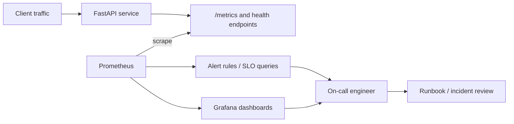

# SRE observability platform — Architecture & Interview Guide

Local observability stack with a demo API, Prometheus scraping, Grafana dashboards, alert rules and incident runbooks. Alert behavior and dashboards should be verified against a running stack.

## Architecture diagram

## Interview questions

1. 1. What are the four golden signals of monitoring?
2. 2. How do you define an SLI and an SLO for an API?
3. 3. What is the difference between availability and reliability?
4. 4. How do you calculate a 5xx error ratio in PromQL?
5. 5. How does histogram_quantile calculate p95 latency?
6. 6. Why should alerts be symptom-based rather than every metric threshold?
7. 7. What is an error budget and how does it affect release decisions?
8. 8. How do you reduce alert fatigue?
9. 9. What information belongs in an incident runbook and postmortem?
10. 10. How would you validate an alert end-to-end and capture genuine evidence?

## Interview preparation note
Answer with architecture rationale, security controls, operational failure scenarios, observability and test evidence. Clearly label implemented, CI-validated, deployed and planned scope.

## Interview questions — suggested answers

### 1. Answer

The four golden signals are latency, traffic, errors and saturation. They provide a practical starting point for user-facing service health.

### 2. Answer

An SLI is a measured ratio/value such as successful requests over total requests; an SLO sets a target over a time window, such as 99.9% over 30 days.

### 3. Answer

Availability measures whether a service is usable; reliability is broader and includes consistent behavior, durability, correctness and recovery under failure.

### 4. Answer

Compute 5xx rate divided by total request rate over the same window and labels. Guard against zero denominators and ensure labels align.

### 5. Answer

histogram_quantile estimates a quantile from cumulative histogram buckets. Aggregate bucket rates by the le label before applying the function.

### 6. Answer

Symptom-based alerts detect user-visible impact; low-level thresholds often fire during harmless fluctuations and create noise. Alert on actionable conditions.

### 7. Answer

An error budget is the allowed failure implied by the SLO. When consumed too quickly, teams may slow risky releases and prioritize reliability work.

### 8. Answer

Use alert grouping, deduplication, severity, actionable thresholds, ownership, runbooks and regular review. Remove alerts that do not lead to action.

### 9. Answer

Runbooks give diagnosis and mitigation steps; postmortems capture timeline, impact, contributing factors and owned actions without blame.

### 10. Answer

Generate controlled traffic/failure, verify Prometheus query and alert state, inspect notification delivery and capture real dashboard screenshots from the running stack.

## Complete zero-to-hero guide

See [ZERO-TO-HERO.md](./ZERO-TO-HERO.md) for the business scenario, architecture walkthrough, tool-by-tool explanations, implementation sequence, practical commands, troubleshooting playbook and additional scenario-based interview questions with answers.
