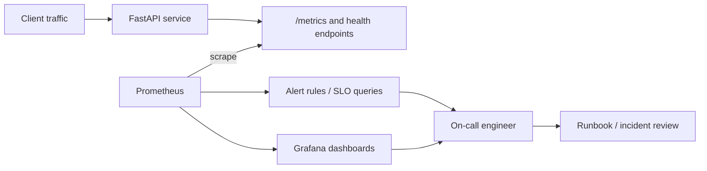

# SRE observability platform — Architecture & Interview Guide

Local observability stack with a demo API, Prometheus scraping, Grafana dashboards, alert rules and incident runbooks. Alert behavior and dashboards should be verified against a running stack.

## Architecture diagram

## Interview questions

1. 1. What are the four golden signals of monitoring?
2. 2. How do you define an SLI and an SLO for an API?
3. 3. What is the difference between availability and reliability?
4. 4. How do you calculate a 5xx error ratio in PromQL?
5. 5. How does histogram_quantile calculate p95 latency?
6. 6. Why should alerts be symptom-based rather than every metric threshold?
7. 7. What is an error budget and how does it affect release decisions?
8. 8. How do you reduce alert fatigue?
9. 9. What information belongs in an incident runbook and postmortem?
10. 10. How would you validate an alert end-to-end and capture genuine evidence?

## Interview preparation note
Answer with architecture rationale, security controls, operational failure scenarios, observability and test evidence. Clearly label implemented, CI-validated, deployed and planned scope.
