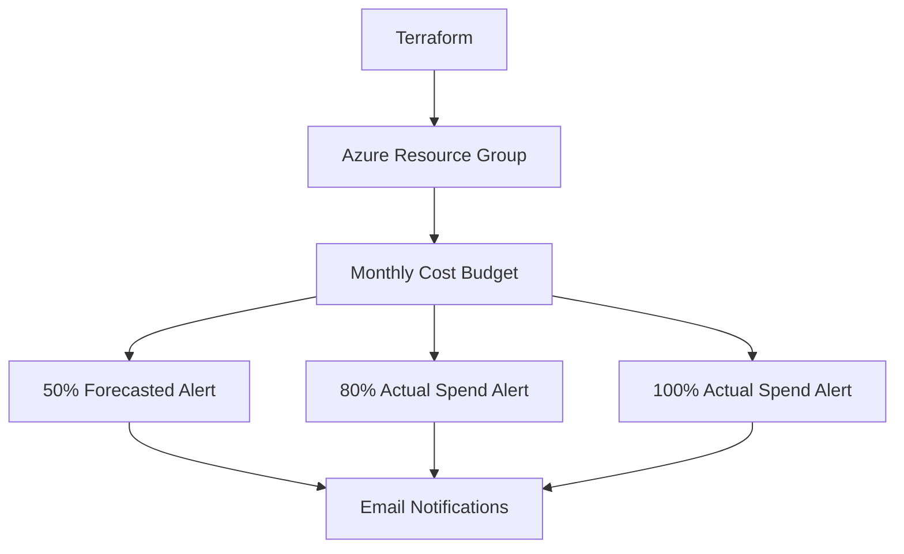

# Azure Cost Guardrails with Terraform

A small portfolio lab that provisions an Azure Resource Group and attaches a monthly Azure Consumption Budget with alert notifications. It demonstrates Infrastructure as Code, cost governance, input validation, tagging, and safe deployment practices.

> **Important:** Azure budgets are alerting controls, not hard spending caps. Azure charges can continue after a threshold is reached. Validate provider/API behavior in a non-production subscription before relying on budget alerts.

## Architecture



## Prerequisites

- Terraform CLI
- Azure CLI
- An Azure subscription with permission to create a resource group and budget
- A valid notification email address

## Deploy

Authenticate interactively:

```powershell
az login
az account set --subscription "<SUBSCRIPTION_ID>"
az account show --output table
terraform init
terraform fmt -check
terraform validate
terraform plan -out tfplan
terraform apply tfplan
```

Create a local `terraform.tfvars` file (do not commit it):

```hcl
subscription_id      = "00000000-0000-0000-0000-000000000000"
location             = "eastus"
resource_group_name  = "rg-cost-guardrails-demo"
budget_amount        = 50
notification_email   = "you@example.com"
```

Budget amounts are in the subscription's billing currency. Choose a value appropriate for your subscription.

## Cleanup

Review the plan before destroying. This lab creates Azure resources that may incur charges:

```powershell
terraform plan -destroy
terraform destroy
```

## Security and production notes

- Never commit credentials, state files, plans, or local `terraform.tfvars`.
- Use Azure CLI authentication for this local lab; use workload identity federation for CI/CD rather than long-lived client secrets.
- Budget notifications are not a spending lock and can be delayed.
- Use a dedicated test subscription and confirm permissions and budget scope with your Azure administrator.

## What this demonstrates

Terraform provider configuration, variables and validation, Azure resource tagging, consumption budgets, notification thresholds, planning before applying, and teardown discipline.
