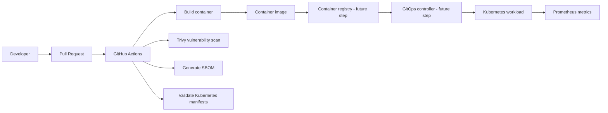

# Secure GitOps Platform — Kubernetes Delivery Blueprint


A recruiter-facing platform engineering lab showing how to deliver a containerized service with a secure CI pipeline and Kubernetes-ready GitOps configuration. It focuses on repeatable delivery, workload hardening, observability hooks, and operational readiness—not just a Dockerfile.

> **Status:** Repository blueprint and CI workflow are committed. The workflow must run in GitHub Actions, and deployment to a real Kubernetes cluster is a separate validation step. Do not describe this as production-deployed until you have tested it in a cluster.

## Architecture



## What this project demonstrates

- **Secure CI:** builds a container, scans filesystem and image, and generates a CycloneDX SBOM.
- **Kubernetes hardening:** non-root execution, read-only root filesystem, dropped Linux capabilities, resource requests/limits, probes, rolling updates, and a PodDisruptionBudget.
- **Traffic controls:** Service, NetworkPolicy, and HorizontalPodAutoscaler examples.
- **GitOps-ready layout:** declarative manifests designed to be reviewed in pull requests.
- **Operations:** SLO/error-budget notes and an incident runbook.

## Repository layout

```text
secure-gitops-platform/
├── app/                  # Minimal FastAPI service
├── k8s/                  # Deployment, Service, HPA, PDB, NetworkPolicy
├── scripts/              # Local validation helper
├── docs/                 # SLO and incident runbook
├── Dockerfile
├── requirements.txt
└── .github/workflows/ci.yml
```

## Run locally

Requirements: Docker Desktop or Docker Engine.

```bash
docker build -t secure-gitops-demo:local .
docker run --rm -p 8000:8000 secure-gitops-demo:local
```

Check the API:

- `http://localhost:8000/health`
- `http://localhost:8000/ready`
- `http://localhost:8000/metrics`

## Validate manifests

Install `kubectl` and `kustomize`, then run:

```bash
kubectl kustomize k8s
kubectl apply --dry-run=client -k k8s
```

A client-side dry run is a syntax/basic schema check; it is not a substitute for applying to a real cluster or checking cluster-specific policy.

## Security model

- Container runs as UID 10001 and does not require root.
- Kubernetes pod uses a read-only root filesystem and drops all Linux capabilities.
- Resource requests and limits are explicit.
- Image and source filesystem are scanned in CI.
- SBOM is generated for software inventory.
- No credentials or cloud keys are stored in this repository.

## Next steps for a real environment

1. Pin base images and GitHub Actions to immutable digests/SHAs.
2. Configure image signing and provenance attestations.
3. Push images to ACR/ECR/GHCR using short-lived OIDC identity.
4. Add Argo CD or Flux to reconcile a dedicated deployment repository.
5. Enforce Pod Security Standards and admission policies.
6. Test NetworkPolicy behavior in the target CNI.
7. Add authenticated ingress, TLS, secret management, and a real metrics scrape configuration.
8. Run load tests, failure injection, and recovery exercises.

## Important production caveats

The manifests are a reusable learning blueprint, not a complete production platform. The NetworkPolicy assumes a cluster CNI that enforces policies; the Prometheus ServiceMonitor requires the Prometheus Operator CRD. Configure ingress, TLS, identity, secrets, and registry access for your target cluster before production use.
