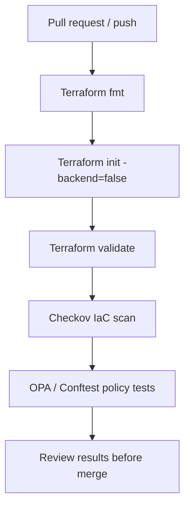

# Terraform Security Policy Gate

A practical DevSecOps guardrail that makes Terraform changes pass formatting, validation, IaC scanning, and policy tests before merge.


## Why it matters

A successful `terraform apply` does not prove an infrastructure change is secure. This lab introduces preventive controls into the pull-request workflow so common misconfigurations are detected before deployment.

## Pipeline



## Controls demonstrated

- Terraform formatting and static validation.
- Checkov scanning of Terraform source.
- OPA/Rego policy examples for secure storage configuration.
- Positive and negative policy fixtures to prove the rules behave as expected.
- GitHub Actions workflow with read-only repository permissions.
- No cloud credentials, subscription access, or deployment step required for CI.

## Repository layout

```text
terraform-policy-gate/
├── .github/workflows/security-gate.yml
├── infra/
│   ├── main.tf
│   ├── variables.tf
│   └── outputs.tf
├── policy/
│   └── storage.rego
├── policy-tests/
│   ├── secure-storage.json
│   └── insecure-storage.json
├── .checkov.yaml
└── README.md
```

## Run locally

Prerequisites: Terraform, Python/pip (for Checkov), and Conftest.

```bash
cd projects/terraform-policy-gate/infra
terraform fmt -check -recursive
terraform init -backend=false
terraform validate
```

Run IaC scanning from the project directory:

```bash
checkov -d infra --config-file .checkov.yaml
```

Run the policy fixtures:

```bash
conftest test policy-tests/secure-storage.json --policy policy
conftest test policy-tests/insecure-storage.json --policy policy
```

The secure fixture should pass; the insecure fixture is expected to fail the policy. For a quick negative test in CI, the workflow inverts the expected result for that fixture.

## Safe usage notes

- The Terraform configuration is an example, not a deployment to your Azure subscription.
- The storage account name must be globally unique before you deploy it.
- Do not add credentials to Terraform files or GitHub secrets for this lab.
- Policy fixtures test the policy logic; they are not a substitute for scanning a real Terraform plan in a production pipeline.
- Checkov findings must be reviewed; this workflow does not certify the infrastructure as risk-free.

## Next steps

1. Extend policies to Key Vault, network security groups, private endpoints, and diagnostic settings.
2. Add plan JSON generation in a protected environment and evaluate the actual plan with OPA.
3. Pin third-party GitHub Actions to full commit SHAs and configure branch protection.
4. Publish a SARIF report to GitHub Security when repository permissions and settings allow it.

## Author

**MD Amirul Haque** · [GitHub](https://github.com/haqueamir70-coder) · [LinkedIn](https://www.linkedin.com/in/md-amirul-haque/)
